# Ivan Daka

**Senior AI Engineer & Full-Stack Developer**, 12+ years in production

Full career, case by case: **[dakaio.com](https://dakaio.com)**

I build production AI inside systems that have to stay up. Twelve years of architecture across
finance, media and healthcare came first, so the models I ship live in services with real
constraints rather than in notebooks.

 

##  About Me

### What I'm doing now

Senior AI/ML Engineer at one of the world's largest cryptocurrency exchanges.

- Fine-tuned a proprietary LLM on internal and open source data for market and risk analysis,
  cutting manual review time by roughly **31%**
- RAG pipelines over live market data, vector search, and AI agents that carry out real work
  rather than answer questions
- Real-time fraud and risk detection inside latency-sensitive trading paths, reducing fraud
  losses by an estimated **24%**
- Smart contracts behind the trading and analytics infrastructure, **$2.3M+ daily volume**

### Before that

| | |
|---|---|
| **Arkis** | Lead engineer. Built an institutional crypto prime broker from zero: infrastructure, smart contracts, product. **$100M+ in credit deployed, zero bad debt** |
| **DreamWorks Animation** | The in-house tools artists create and render films with, including the software behind *Puss in Boots*, *The Wild Robot* and *The Bad Guys*. Real-time 3D in the browser, 50GB+ assets edited without ever loading them whole |
| **Luxoft** | Olympic Channel real-time streaming and the move to microservices. Healthcare systems under HIPAA and GDPR |
| **LogicManager** | Team lead, 11 engineers. Rewrote the platform from ActionScript to React against a hard deadline while it stayed live under regulatory oversight |
| **Squarespace** | The platform core, the editing surface every customer builds their site in |
| **Deutsche Bank** | The internal risk platform, thousands of risk factors tracked live |

 

##  Skills

<table width="100%">
<tr>
<td valign="top" width="50%">

<b> AI models</b>

</td>
<td valign="top" width="50%">

<b> AI engineering</b>

</td>
</tr>
<tr>
<td valign="top" width="50%">

<b> Backend</b>

</td>
<td valign="top" width="50%">

<b> Frontend</b>

</td>
</tr>
<tr>
<td valign="top" width="50%">

<b> Data</b>

</td>
<td valign="top" width="50%">

<b> Web3</b>

</td>
</tr>
<tr>
<td valign="top" width="50%">

<b> Infra</b>

</td>
<td valign="top" width="50%">

<b> Telegram</b>

</td>
</tr>
</table>

 

##  Working preferences

- **Location:** Dubai, UTC+4. Worked California hours for two and a half years at DreamWorks from
  here, so time zones are not an obstacle
- **Format:** Remote, full-time or contract
- **Open to:** Senior AI, full-stack, backend and engineering lead roles

 

##  Let's connect

&nbsp;

&nbsp;

&nbsp;

